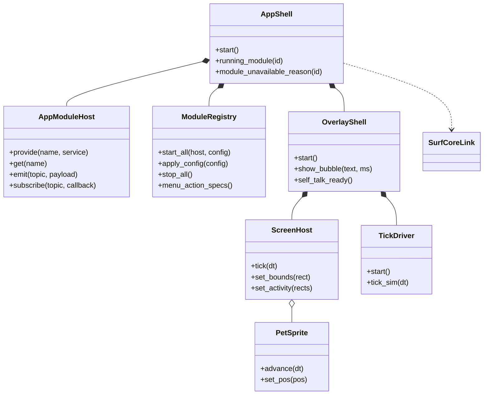

# Engineering guide

> 个人硬分叉：只支持 Windows，结构已模块化（核心 + `pet/modules/<id>/`），SurfCore 以 `surfcore/` 子目录合入。本文件描述现状，不描述上游历史。

## Project shape

This is a Windows-only PySide6 desktop pet. `python -m pet` enters through
`pet/__main__.py`; `--settings` starts a separate settings process that reads
config and module manifests only (it never starts the module runtime),
`--ocr-worker` runs the local OCR subprocess, and `--uninstall-cleanup` runs
without a GUI. The main process builds one `QApplication`, one `Config`, one
`AppShell`, and one `OverlayShell`. Keep Qt objects on their owning thread and
communicate across threads with queued signals.

**One pet, one overlay window.** The only product topology is the overlay path:
there is no legacy single-window `PetWindow`, no capture-mode topology switch,
and no second pet. The pet is slot 0: per-pet preferences live in
`config-slot-0.json`, global settings in `config.json`, and the profile is
migrated/backed up by `pet/pet_profiles.py`; a corrupt slot-0 profile degrades
that slot only and is reported with its path, while global-config damage still
aborts startup. `OverlayShell` owns the one transparent window whose bounds are
the union of all connected screens' work areas. A `ScreenHost` holds that
window's `bounds`, its activity rectangles, the behaviour controller and
per-screen bookkeeping; `PetSprite` is the single pet drawn inside it.
`TickDriver` is the single timer that advances behaviour, sprites and island
animation. Cross-screen is the same window moving the sprite between activity
rectangles (gated by the global `allow_cross_screen` key, default off).

**Modules are the feature layer.** A module is a package under
`pet/modules/<id>/` registered in `pet/modules/__init__.py::MODULES`. Its
`__init__.py` only declares `MANIFEST = ModuleManifest(...)` (cheap: no Qt, no
runtime import). The manifest's string entry points (`factory`,
`menu_actions`, `config_schema`, `settings_page`) are resolved lazily with
`pet.modules.base.load_entry`, because the settings process and the menu
registry must import only the page/menu code, never start a module.
`ModuleRegistry` (`pet/modules/registry.py`) reads manifests, orders them by
`requires`/`optional`, starts them with an `AppModuleHost`
(`pet/module_host.py`), forwards config, and stops them in reverse order; one
broken module is isolated and its reason is visible. `AppModuleHost` is the
only surface a module may use: config, bubbles/notifications, dialogs, island
contributions, a service table (`provide` / `get`) and a queued event bus
(`emit` / `subscribe`). `pet/module_config.py` merges module config schemas so
defaults, normalization and key ownership stay with the module instead of the
global `config.py`.

Module rules (guarded by `tests/test_module_architecture.py` and
`tests/test_module_registry.py`):

- **Delete a module = delete its directory + remove its `MODULES` line.** Its
  defaults, config keys, menu actions and settings page disappear with it;
  dependants render as disabled with a stated reason.
- **Core never imports `pet.modules.<id>`.** Core reads a module's capability
  through `pet.module_host.module_service(shell, "<id>")` (or the host's
  service table); missing/unstarted means the feature is off, not an error.
- **Modules never import each other.** Cross-module capabilities go through
  `host.provide` / `host.get` or topics on the host event bus.
- **The settings process reads manifests only.** It merges menu/page string
  entries but never constructs `ModuleRegistry`/module runtimes.

Current `MODULES` (registration order; startup order follows dependencies):
`surfcore`, `harness`, `agent_link`, `hotkeys`, `self_talk`, `network_info`,
`focus`, `quick_launch`, `todo`, `balance`. Core owns application lifecycle, config,
the overlay/sprite/tick pipeline, animation media (WebM/frame sequences/
ffmpeg), base interaction, the edge probe, bubbles, dynamic island shell,
tray, menu/settings frameworks, quiet mode, desktop notifications and
autostart.

**SurfCore and the two dialogue lines.** `surfcore/` is the whole SurfCore
Node/DSH plugin (QQ bridge, memory, persona, quota, console) and is not Python;
it may be edited here but does not import the pet. The pet is its client:
`pet/modules/surfcore/` discovers `~/.dsh/surfcore/pet/host.json`, talks only
to loopback with the pet token, long-polls events, exposes the `surfcore`
service and syncs focus state. `pet/surfcore_link.py` is the core-side seam
used by direct-API features (cached persona card, budget gate, usage reporting,
proactive claim); it reads the service and never imports the SurfCore module.
D5 splits dialogue into a **companion line** (quick bubble, island chat,
proactive talk, self-talk — through SurfCore) and an **assistant line** (full
AI chat window and screen-looking — direct API, with persona always from the
SurfCore persona card). SurfCore being offline disables the companion messages
with a reason and falls back to cached persona/local self-talk presets; it is
not a second direct-API path.

**Agent link.** The DSH bridge (`integrations/dsh-pet-bridge/`) tags each
session with its agent preset. Agent link is the `agent_link` module
(`pet/modules/agent_link/`): `DshMonitor` in `agent_link.py` drops every
session whose preset starts with `qq-chat` before state-machine/ingest
dispatch, so only real agents drive the pet (D7). The bridge directory has
exactly one reader; parsed records feed both signal dispatch and the pure
8-state converger in `dsh_state.py`. Core reads it through the `agent_link`
host service / `agent_link.event`; with the module removed the pet runs with
agent link off.

**Local data directory.** `start-local.bat` (the user's daily launcher) sets
`APPDATA` to `<repo>\.local\appdata`, so its config lives under the repo, not
in `%APPDATA%`. Anything that relaunches the pet (autostart, restarts) must
keep that redirect or it will start against a different config.

Packaging: `scripts/build_onedir.ps1` must collect the whole `pet.modules`
package with `--collect-submodules pet.modules`, because every module is
reached through a string entry point. `tests/test_module_packaging.py` guards
that line and resolves every `MODULES` entry plus every manifest string entry
point without running PyInstaller. There are no macOS/Linux/Android builds.

## Change discipline

- Preserve user changes in a dirty worktree and keep generated build output out
  of commits.
- Fix behavior test-first at a public seam. For Qt regressions, use real
  event loops and process boundaries; mock only operating-system or network
  boundaries that cannot run deterministically.
- A fix is complete when the focused regression is red before the product
  change, green afterward, and verification matches the risk gate below.
- Run the full suite for shared models/config migrations, application lifecycle,
  threading, packaging/dependencies, platform branches, changes spanning
  multiple test domains, or the final accumulated branch before merge.
- Focused plus related tests are sufficient for a local presentation token or
  isolated widget behavior when interfaces, persisted data, lifecycle, and
  platform dispatch are unchanged. Record why the full suite was skipped.
- Keep QLocal test server names short. POSIX converts names to Unix socket paths,
  whose limit includes the system temporary-directory prefix.

## Verification gates (2026-11-03 起，硬分叉后的口径)

本仓库已是个人硬分叉，不再向上游提 PR：**逐 PR 的三证据报告
（`docs/PR-REPORT-*`）不再要求**，历史报告只作参考。测试门保留，但要快：

- 任务内：ruff（`ruff check pet/ tests/ scripts/`）+ 与改动相关的测试文件。
- 阶段边界 / 合并进集成分支前：全量 pytest（并行，`-n 6`；本机 16GB 内存，
  `-n 12` 时测试进程合计约 8GB、把系统挤到只剩 0.7GB 空闲，别用 `-n auto`），
  失败的用例再单进程复跑一次，区分真失败与并行时序抖动。
- 删除功能时，同时删掉只测试该功能的测试文件；不要为了让测试通过而
  保留死代码。
- 写时序测试：涉及真实线程 / Qt 事件循环时一律事件同步（Event/Condition）
  + 宽预算，禁止固定 sleep 猜时序、禁止赌目录枚举顺序。

Run focused tests before `python -m pytest -q`. Set
`QT_QPA_PLATFORM=offscreen` in headless environments.

## Agent skills

### Issue tracker

Issues and specs use Local Markdown under `.scratch/<feature-slug>/`. See
`docs/agents/issue-tracker.md`.

### Triage labels

Use the five canonical local triage states. See
`docs/agents/triage-labels.md`.

### Domain docs

Use the single-context layout: root `CONTEXT.md` and system ADRs under
`docs/adr/`. See `docs/agents/domain.md`.

### Qt UI review

Use `.agents/skills/qt-ui-review/SKILL.md` when reviewing settings, menus,
overlays, QSS, accessibility, or desktop presentation.

### Qt UI development

Use `.agents/skills/desktop-pet-ui-style/SKILL.md` when adding or materially
restyling settings, menus, dialogs, overlays, or desktop widgets.

### Work handoff

For unfinished multi-ticket work, read and refresh the feature's
`.scratch/<feature-slug>/HANDOFF.md` before ending or resuming work. Keep the
exact breakpoint there; see `docs/agents/handoff.md`.

## Context pointers

找文档先查 `docs/INDEX.md`（全文档入口索引：每条一句话 + 何时必读）；
新文档入场必须按其中的规则登记并互链。高频专项指针：

- Read `docs/ISSUE-111-WINDOWS-SESSION-END-FFMPEG-2026-09-12.md` when changing
  ffmpeg spawning (`webm_clip` reader/first-frame/meta/exe probes), warm
  scheduling, or anything that runs during Windows shutdown/logoff
  (`session_watcher`, `match_shutdown`, `AppShell._on_session_end`).
- Read `docs/ONEDIR_PACKAGING.md` when changing PyInstaller specs, bundled
  resources, module collection, or Windows build scripts.
- Read `docs/PR-REPORT-FRAMESEQ-ALPHA-FLOOR-2026-10-16.md` when changing the
  frame-sequence encode grade or unblend chain
  (`pet/frameseq_provision.py`: `ENCODER_DESC` / `UNBLEND_MARK` / `unblend_v3` /
  `floor_faint_alpha`), the build-time material gate
  (`scripts/check_frameseq_bundle.py`, whose grade constants must stay
  byte-identical to the runtime ones), or when deciding whether frame-sequence
  material must be re-generated. Current grade is `unblend-white-v5` (v3 is
  history); v4 (hole restore) is suspended and is **not** a grade.
- Read `docs/STABLE_BUILDS.md` when changing release/build workflows.
- Read `docs/CONTEXT-MENU-RESEARCH-AND-REFACTOR-2026-08-25.md` when changing
  context-menu structure, styling, interaction, or platform behavior.
- Read `docs/SETTINGS-CHANGE-GATES.md` before adding, moving, removing, or
  changing a persistent setting or its settings-page interaction.
- Read `docs/PERSONA-PHRASES-PRESET-STORAGE-2026-09-08.md` before changing
  dialogue preset files (`pet/persona_presets/*.json`), phrase loading
  (`persona_phrases.py`), or expression-style semantics
  (`dialogue_mode`/`dialogue_phrases`).
- Read `docs/PR-MERGE-LESSONS-2026-09-12.md` before merging stacked branches:
  conflicts after squashing a parent, budget/red-line changes that only break
  when two changes combine, and timing-test flake discipline (poll state with a
  wide budget instead of fixed sleeps).
- Read `docs/NETWORK-PROXY-AND-VPN-2026-09-22.md` when touching any networked
  feature (balance, vision/screen APIs, AI chat, SurfCore loopback discovery) or
  when a report sounds like "X worked yesterday and now it doesn't": the Windows
  system proxy / VPN is a first-class suspect. Never log proxy addresses,
  credentials, tokens, or raw exception/URL text.
- Treat `assets/characters/<id>/videos/` plus its manifest as one character
  package; preserve relative paths and case. The manifest may declare
  `body_box` (`[x1, y1, x2, y2]` in source pixels, mirror-symmetrized): the
  stable body rect used as the placement/edge-clamp anchor
  (`pet/catalog.py character_body_box`); measure it at alpha≥128 to match the
  mask/visual edge, and omit it to fall back to full-canvas behavior.
