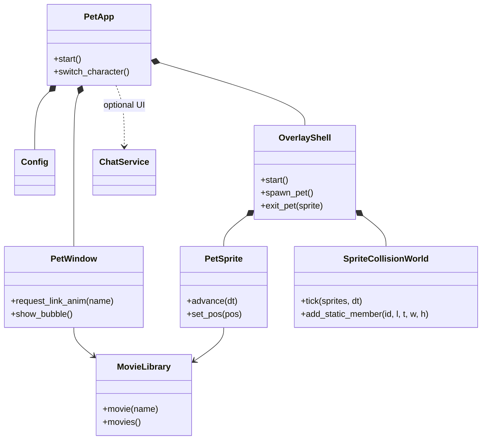

# Engineering guide

> **重构进行中（2026-11-03 起，分支 `refactor/modular`）**：本仓库是个人硬分叉，只支持 Windows，
> 正在删除大量功能并改造成模块化结构，同时在 `surfcore/` 下合入了 SurfCore（Node DSH 插件 + QQ 桥接）。
> 需求、决策和阶段计划以 `.scratch/modularization/spec.md` 为准；下面的「Project shape」
> 仍在描述旧结构（多开、legacy 拓扑、跨平台），会在阶段 4 重写，与 spec 冲突时以 spec 为准。

## Project shape

This is a PySide6 desktop-pet application. `python -m pet` enters through
`pet/__main__.py`; `PetApp` owns application-level services, `PetWindow` owns
interactive pet behavior, and `MovieLibrary` owns animation media. Keep Qt
objects on their owning thread and communicate across threads with queued
signals.

**Two render topologies, one process.** `PET_RENDER_TOPOLOGY=overlay` (dev env
flag, read only in `pet/overlay_shell.is_overlay_topology`) renders every pet as a
`PetSprite` inside an `OverlayWindow`; multi-pet is in-process
(`AppShell.spawn_in_process_window` / `OverlayShell.spawn_pet`, slot identity via
`pet/overlay_spawn_state.py`). Each **occupied display** has its own
`OverlayWindow`, owned by a `pet/screen_host.ScreenHost` that also owns that
screen's behaviour/collision/physics worlds (screen-local coordinates: equal local
coordinates on two displays are not the same point), while the shell, the
`TickDriver` timer and every shared service stay single. `OverlayShell.overlay`
and the three controllers are the *home* host's views; anything that means
"every pet/window" enumerates `shell.hosts()`. `host_for_sprite(sprite)` and
`move_sprite_to_screen(sprite, screen, global_pos=None)` are the per-pet screen
seams (normal drag crosses screens with them; `ScreenHost` bounds come from the
profile's `screen_name`/`rx`/`ry`). The whole cross-display capability is gated by
the global `allow_cross_screen` key (default off, snapshotted once per process like
`stream_capture_mode`): off = every pet stays on the screen the shell started on,
one window, drags cannot cross, no second host is created. `screen_name` is the
pet's *screen assignment*: it is stamped at first placement (every pet, so a child
never silently follows the main pet to another display) and rewritten only by a
deliberate cross-screen move (`_remember_sprite_screen`). `_save_child_geometry`
writes the assignment together with ratios/facing/scale **only while the pet is on
its assigned screen**; a temporary host (switch off, or the assigned screen
unplugged) writes no geometry key at all, so neither the assignment nor the ratios
it recorded on its own screen are eaten — turning the switch back on and restarting
returns each pet to its own screen at its own position. The topology verdict also reads the persistent
`stream_capture_mode` key (main `config.json`, snapshotted once per process by
`pet/overlay_settings_command.is_overlay_topology`): capture mode is a
restart-level switch to the legacy single-window path, where the pet is a real
title-bearing window OBS can enumerate (the window capability follows the main
config), only active slot0 has a capture window. Restoring slot0 is allowed;
extra pets are refused without modifying the stored child active identities.
`--slot N` selects an existing active identity, never creates a second instance
or activates an empty slot. `PetWindow` remains the capture/legacy surface; use
`SlotRoutedConfig` for its profile/global ownership rather than a second truth.

Pet identities are fixed 0..128. Profiles live only in `config-slot-N.json`,
global settings in `config.json`, and active membership in versioned
`overlay-active-pets.json`. Closing a pet preserves its profile and services,
never promotes another pet or quits the app. Application exit preserves active
membership. Profile writes/reset share the directory lock and profile generation;
raw slot `Config.save` is intentionally refused. A corrupt `config-slot-0.json`
degrades that slot only: it stays empty (kept out of the in-memory active set),
its file is never touched, and the diagnosis names its path — every other
non-ok `migrate_slot0_profile` status still aborts startup, because those mean
the global config or the migration itself is untrustworthy. Active membership is
written only by explicit user generate/close, and those writes back up a corrupt
`overlay-active-pets.json` before replacing it (`on_broken="backup-overwrite"`)
and report a failure visibly; startup and exit never rewrite it. Reset and
autostart are global-scope settings reachable from every pet's settings page:
the sidebar exposes per-pet and global reset as two separate actions, and
`autostart_wanted` is editable everywhere with its "affects all pets" scope
stated in the row.

The multi-process multi-pet layer (cross-process collision IPC, slot file locks,
instance launcher, child-pet taskkill cleanup, runtime-marker live consumers) was
deleted in Phase 4.4b; `tests/test_architecture.py` guards that the retired modules
stay gone and are never imported again. Collision math is pure (`pet/collision.py`
+ `pet/sprite_collision.py`); the island's stadium clamp lives in
`sprite_collision.capsule_circles` via `pet/island_bridge.py`.

`pet/multi_window_shared.py` is always on: one process-wide agent_link /
proactive / fullscreen watcher fanned out to every window or sprite. Under the
overlay topology the shared fullscreen watcher is not started (the overlay shell
owns its own `FullscreenCursorWatcher`). The DSH bridge directory has exactly one
reader: `DshMonitor` (one `DirGlobTailer` + one polling thread; parsed records feed
both the signal dispatch and the pure 8-state converger in `pet/dsh_state.py`,
with the DSH port probe folded into the same thread), started by
`AgentLinkManager.apply_config` only while `agent_link.dsh` is enabled.

## Change discipline

- Preserve user changes in a dirty worktree and keep generated build output out
  of commits.
- Fix behavior test-first at a public seam. For Qt regressions, use real
  event loops and process boundaries; mock only operating-system or network
  boundaries that cannot run deterministically.
- A fix is complete when the focused regression is red before the product
  change, green afterward, and verification matches the risk gate below.
- Run the full suite for shared models/config migrations, application lifecycle,
  threading, packaging/dependencies, platform branches, changes spanning
  multiple test domains, or the final accumulated branch before merge.
- Focused plus related tests are sufficient for a local presentation token or
  isolated widget behavior when interfaces, persisted data, lifecycle, and
  platform dispatch are unchanged. Record why the full suite was skipped.
- Keep QLocal test server names short. POSIX converts names to Unix socket paths,
  whose limit includes the system temporary-directory prefix.

## Verification gates (2026-11-03 起，硬分叉后的口径)

本仓库已是个人硬分叉，不再向上游提 PR：**逐 PR 的三证据报告
（`docs/PR-REPORT-*`）不再要求**，历史报告只作参考。测试门保留，但要快：

- 任务内：ruff（`ruff check pet/ tests/`）+ 与改动相关的测试文件。
- 阶段边界 / 合并进集成分支前：全量 pytest（并行，`-n auto`），失败的用例
  再单进程复跑一次，区分真失败与并行时序抖动。
- 删除功能时，同时删掉只测试该功能的测试文件；不要为了让测试通过而
  保留死代码。
- 写时序测试：涉及真实线程 / Qt 事件循环时一律事件同步（Event/Condition）
  + 宽预算，禁止固定 sleep 猜时序、禁止赌目录枚举顺序。

Run focused tests before `python -m pytest -q`. Set
`QT_QPA_PLATFORM=offscreen` in headless environments. A restricted macOS
sandbox may deny Unix socket creation; rerun QLocalServer tests with local IPC
permission rather than treating errno 1 as a product failure.

## Agent skills

### Issue tracker

Issues and specs use Local Markdown under `.scratch/<feature-slug>/`. See
`docs/agents/issue-tracker.md`.

### Triage labels

Use the five canonical local triage states. See
`docs/agents/triage-labels.md`.

### Domain docs

Use the single-context layout: root `CONTEXT.md` and system ADRs under
`docs/adr/`. See `docs/agents/domain.md`.

### Qt UI review

Use `.agents/skills/qt-ui-review/SKILL.md` when reviewing settings, menus,
overlays, QSS, accessibility, or cross-platform desktop presentation.

### Qt UI development

Use `.agents/skills/desktop-pet-ui-style/SKILL.md` when adding or materially
restyling settings, menus, dialogs, overlays, or desktop widgets.

### Work handoff

For unfinished multi-ticket work, read and refresh the feature's
`.scratch/<feature-slug>/HANDOFF.md` before ending or resuming work. Keep the
exact breakpoint there; see `docs/agents/handoff.md`.

## Context pointers

找文档先查 `docs/INDEX.md`（全文档入口索引：每条一句话 + 何时必读）；
新文档入场必须按其中的规则登记并互链。高频专项指针：

- Read `docs/ISSUE-111-WINDOWS-SESSION-END-FFMPEG-2026-09-12.md` when changing
  ffmpeg spawning (`webm_clip` reader/first-frame/meta/exe probes), warm
  scheduling, or anything that runs during Windows shutdown/logoff
  (`session_watcher`, `match_shutdown`, `AppShell._on_session_end`).
- Read `docs/ONEDIR_PACKAGING.md` when changing PyInstaller specs, bundled
  resources, or platform build scripts.
- Read `docs/PR-REPORT-FRAMESEQ-ALPHA-FLOOR-2026-10-16.md` when changing the
  frame-sequence encode grade or unblend chain
  (`pet/frameseq_provision.py`: `ENCODER_DESC` / `UNBLEND_MARK` / `unblend_v3` /
  `floor_faint_alpha`), the build-time material gate
  (`scripts/check_frameseq_bundle.py`, whose grade constants must stay
  byte-identical to the runtime ones), or when deciding whether frame-sequence
  material must be re-generated. Current grade is `unblend-white-v5` (v3 is
  history); v4 (hole restore) is suspended and is **not** a grade.
- Read `docs/ONEDIR_PACKAGING.md` §「随包分发的第三方二进制」and
  `docs/PR-REPORT-GAME-FPS-2026-10-11.md` when touching the game-FPS chain
  (`pet/game_fps.py`, `pet/fps_monitor.py`, `pet/island_fps.py`), the bundled
  PresentMon backend under `resources/presentmon/` (Windows-only, x64-only,
  digests gated by `scripts/verify_presentmon.py` at build time; never installed
  as an MSI/service), or the `fps` member of `island_metrics` and the two
  process-level `game_fps_*` keys. Real frame readings are **not** verified on
  this machine: capture runs with **plain user permissions only** — the pet never
  self-elevates and runs no resident elevated helper. The only elevation is the
  user-clicked, one-time settings button (`pet/fps_permission.py`) that adds the
  current account (token SID) to Performance Log Users via one UAC prompt; it
  takes effect after re-logon. Until then, where the user is not in that
  group the segment shows the raw `access denied` reason
  from the capture backend and keeps no value (never a fake `0`). No ETW session
  or real frame reading has ever been exercised here — do not cite any measured
  FPS as verified.
- Read `docs/STABLE_BUILDS.md` when changing release/build workflows.
- Read `docs/CONTEXT-MENU-RESEARCH-AND-REFACTOR-2026-08-25.md` when changing
  context-menu structure, styling, interaction, or platform behavior.
- Read `docs/SETTINGS-CHANGE-GATES.md` before adding, moving, removing, or
  changing a persistent setting or its settings-page interaction.
- Read `docs/PERSONA-PHRASES-PRESET-STORAGE-2026-09-08.md` before changing
  dialogue preset files (`pet/persona_presets/*.json`), phrase loading
  (`persona_phrases.py`), or expression-style semantics
  (`dialogue_mode`/`dialogue_phrases`).
- Read `docs/PR-MERGE-LESSONS-2026-09-12.md` before merging PRs: stacked-PR
  conflicts after squashing the parent, budget/red-line changes that only break
  when two PRs combine, and timing-test flake discipline (poll state with a wide
  budget instead of fixed sleeps).
- Read `docs/NETWORK-PROXY-AND-VPN-2026-09-22.md` when touching any networked
  feature (music lyrics, edge-tts voice, updater, balance, vision, chat) or when
  a report sounds like "X worked yesterday and now it doesn't": the Windows
  system proxy / VPN is a first-class suspect — it made lyric fetching 20-41s
  (all three sources timed out) on 2026-09-22, while jsdelivr update checks only
  work *through* the proxy. Lyric requests try direct first and fall back to the
  system proxy exactly once — only on a transport failure or HTTP 500/502/504,
  sharing `fetch_lyrics`' single deadline budget (`pet/music_lyric.py`:
  `_build_opener` / `_may_switch_to_proxy` / `_fallback_proxy` /
  `_attempt_timeout`; 404/429/503 and other definitive answers never switch
  routes, and neither does any response carrying `Retry-After`). The fallback
  only counts when the URL's own scheme (http/https) has a proxy that the system
  `proxy_bypass` list does not exempt — a `NO_PROXY`-only or other-scheme config
  is not a second route. Never log proxy addresses, credentials, or raw
  exception/URL text: route names, exception type, HTTP status and `Retry-After`
  only. Other features keep following the proxy.
- Treat `assets/characters/<id>/videos/` plus its manifest as one character
  package; preserve relative paths and case because packaged platforms differ.
  The manifest may declare `body_box` (`[x1, y1, x2, y2]` in source pixels,
  mirror-symmetrized): the stable body rect used as the placement/edge-clamp
  anchor (`pet/catalog.py character_body_box`); measure it at alpha≥128 to
  match the mask/visual edge, and omit it to fall back to full-canvas behavior.
